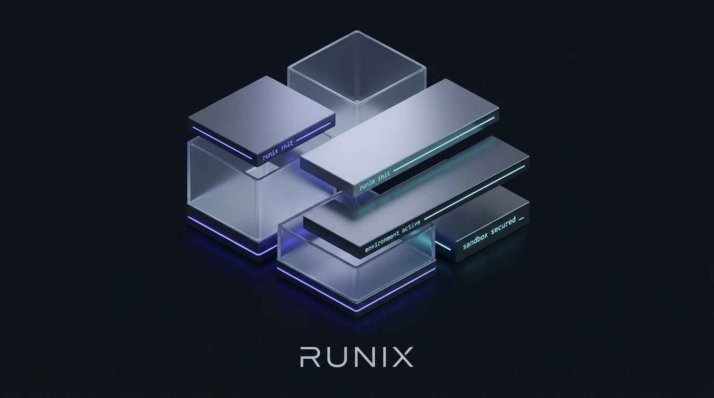
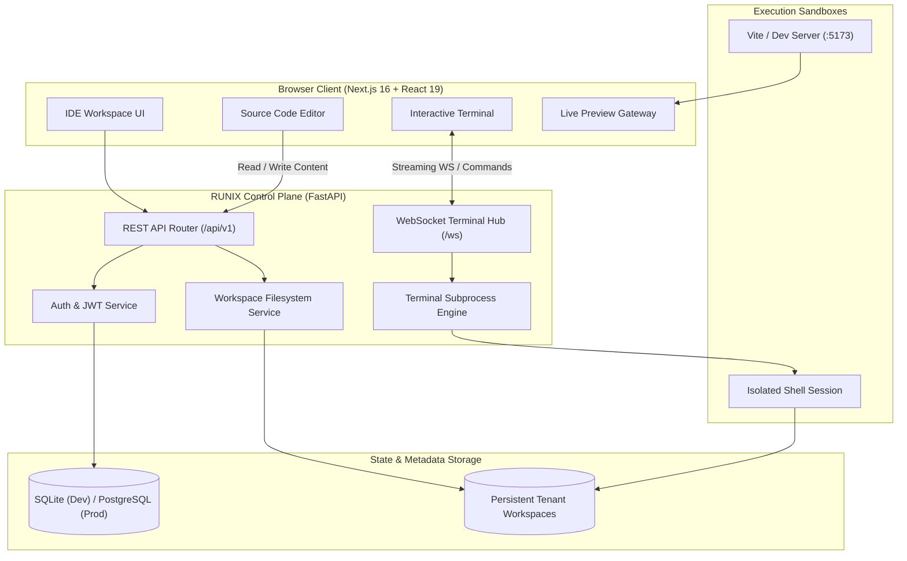

<div align="center">



# RUNIX

### **Build. Run. Ship. Anywhere.**

*A browser-based cloud development platform and isolated runtime engine designed for building, executing, and shipping modern software from anywhere.*

<br/>

[](docs/20-ROADMAP.md)
[](frontend/)
[](backend/)
[](frontend/)
[](backend/)
[](https://stitch.withgoogle.com/projects/2390441801388154937)

<br/>

[Overview](docs/00-PROJECT-OVERVIEW.md) • [Architecture](docs/03-SYSTEM-ARCHITECTURE.md) • [API Spec](docs/06-API-SPECIFICATION.md) • [Terminal Spec](docs/07-WEBSOCKET-SPECIFICATION.md) • [Security](docs/12-SECURITY-ARCHITECTURE.md) • [Roadmap](docs/20-ROADMAP.md)

---

</div>

## Status

> **Current Maturity: Active Development (v0.2.0-dev)**  
> Core control plane services, project templates, persistent file tree, and real-time streaming WebSocket/REST dual-mode terminals are fully operational. Dockerized multi-tenant sandboxes, Monaco LSP integration, and visual Git staging panels are currently in active development.

| Capability | Status | Implementation Details |
| :--- | :---: | :--- |
| **Project & Workspace Management** | `Operational` | Multi-project CRUD, metadata storage, template cloning |
| **File Tree & Safe Filesystem** | `Operational` | Path traversal prevention, UTF-8/UTF-16 BOM support |
| **Interactive Terminal** | `Operational` | Streaming WebSocket (`/ws/...`) + REST command execution fallback |
| **Live Preview Gateway** | `Operational` | Container port routing and sandbox isolation drawer |
| **Developer Authentication** | `Operational` | Argon2 password hashing, JWT bearer tokens, session middleware |
| **Stitch Design System** | `Operational` | Dark graphite aesthetic, typography, and responsive IDE layout |
| **Automated Test Suites** | `Operational` | 25/25 passing unit/integration tests (`pytest`) + Next.js typecheck |
| **Container Sandbox Daemon** | `In Progress` | Isolated Docker micro-VM container provisioning per tenant |
| **Monaco LSP Integration** | `In Progress` | Advanced language server diagnostics and IntelliSense |
| **Visual Git Staging Panel** | `Planned` | In-IDE staging, commit history, and diff inspector |
| **AI Coding Agent** | `Planned` | Context-aware repository analysis and automated patch generation |

---

## Key Features

### ⚡ Persistent Cloud Workspaces
Each project provisions a dedicated, sandbox-isolated workspace storage root (`/tmp/runix/workspaces/<project_id>`). Files are saved atomically with protection against directory traversal attacks (`..` or escaped symlinks).

### 🖥️ Dual-Mode Interactive Terminal
A high-throughput browser terminal supporting real-time streaming WebSockets (`/ws/projects/{project_id}/terminal`) with automatic fallback to REST execution (`POST /api/v1/projects/{project_id}/commands`). Features ANSI formatting, command history (`↑` / `↓`), auto-scroll, and automatic file tree synchronization on process completion.

### 📁 Multi-Encoding File Engine
The file manager supports seamless reading and writing of standard UTF-8, UTF-8 with BOM (`\xef\xbb\xbf`), and UTF-16 LE/BE with automatic BOM detection, preventing encoding corruption across Windows and Linux environments.

### 🎨 Google Stitch Design System
Built from the ground up to match the approved [Google Stitch Design System](https://stitch.withgoogle.com/projects/2390441801388154937). Utilizes a deep graphite (`#0a0e16`), slate (`#181c24`), and indigo (`#4f46e5`) color palette for zero eye fatigue and maximum developer focus.

### 📦 Pre-Configured Project Templates
Instantly scaffold workspaces with clean industry-standard templates:
- **`react-vite-ts`**: React 19, Vite 6, TypeScript
- **`node-express-ts`**: Express REST API, TypeScript, Node.js
- **`python-fastapi`**: Python 3.12+, FastAPI, Pydantic v2
- **`vanilla-ts`**: Zero-dependency TypeScript application

---

## Architecture

RUNIX adheres to a strict separation of concerns: untrusted developer execution is completely isolated from the control plane and API hosts.



---

## Security Architecture

Security is built into every layer of RUNIX:

1. **Host Isolation**: Untrusted user code and shell commands are confined strictly to designated workspace directories. No arbitrary command execution is permitted on the control plane host.
2. **Path Traversal Protection**: Every filesystem operation verifies that the target canonical path resolves strictly within the tenant's allocated root directory. Attempts to escape using `..`, root paths, or symlinks are rejected with `403 Forbidden`.
3. **Structured Error Envelopes**: System exceptions are sanitized through global exception handlers to prevent leaking stack traces, credentials, or internal paths to clients.
4. **Tenant Authorization**: All endpoints enforce strict project ownership checks. Non-members cannot read files, execute commands, or access WebSocket streams.
5. **Request Tracing**: All API and WebSocket events propagate unique `X-Request-ID` headers for end-to-end audit logging.
6. **Credential Hygiene**: The repository strictly enforces `.gitignore` rules. Real secrets, private keys, database binaries, and production certificates are excluded from source control.

---

## Technology Stack

| Layer | Technology | Purpose |
| :--- | :--- | :--- |
| **Frontend Framework** | Next.js 16 (App Router, Turbopack) | Web IDE layout, routing, and server-side rendering |
| **UI Library & Styling** | React 19, Tailwind CSS v4 | Modular UI components, Stitch dark theme tokens |
| **Control Plane API** | FastAPI (Python 3.12+) | High-performance asynchronous REST & WebSocket API |
| **Database** | SQLAlchemy 2.0 (Async), SQLite / PostgreSQL | Relational metadata, project storage, and audit logs |
| **Password Security** | Argon2id & Cryptography | Enterprise password hashing and secure token generation |
| **Real-Time Terminal** | WebSockets + `asyncio.to_thread` Subprocesses | Low-latency bi-directional command and output streaming |
| **Validation & Testing** | `pytest`, `pytest-asyncio`, `tsc` | Automated test suites with 100% pass rate enforcement |
| **Orchestration** | Docker Compose | Local multi-service infrastructure deployment |

---

## Project Structure

```text
RUNIX/
├── AGENTS.md                  # Contributor and AI coding agent guidelines
├── docker-compose.yml         # Local development orchestration (DB, Cache)
├── package.json               # Root monorepo orchestration scripts
├── .env.example               # Environment variable configuration template
├── .gitignore                 # Secrets, build artifacts, and database rules
├── README.md                  # Project overview and architecture documentation
│
├── docs/                      # Complete system & engineering specifications
│   ├── 00-PROJECT-OVERVIEW.md # Executive PRD & product overview
│   ├── 03-SYSTEM-ARCHITECTURE.md
│   ├── 06-API-SPECIFICATION.md
│   ├── 07-WEBSOCKET-SPECIFICATION.md
│   ├── 12-SECURITY-ARCHITECTURE.md
│   ├── 14-DESIGN-SYSTEM.md
│   └── 20-ROADMAP.md
│
├── frontend/                  # Next.js 16 Web IDE interface
│   ├── src/app/dashboard/     # Project management dashboard
│   ├── src/app/workspace/     # Full-featured cloud IDE workspace
│   ├── src/lib/api.ts         # Strongly-typed API and command client
│   └── src/app/globals.css    # Stitch design system CSS tokens
│
├── backend/                   # FastAPI control plane service
│   ├── app/api/v1/            # Auth, projects, files, commands routers
│   ├── app/api/ws/            # Real-time WebSocket terminal hub
│   ├── app/services/          # WorkspaceService, TerminalService, AuthService
│   ├── app/models/            # SQLAlchemy database models
│   └── tests/                 # Comprehensive pytest test suite
│
├── worker/                    # Asynchronous background tasks (.gitkeep)
├── runtime/                   # Containerized execution sandboxes (.gitkeep)
├── infrastructure/            # Kubernetes and Terraform manifests (.gitkeep)
├── scripts/                   # Development utilities (.gitkeep)
└── tests/                     # End-to-end integration tests (.gitkeep)
```

---

## Quick Start

### Prerequisites
- **Node.js** v20+ & **npm**
- **Python** 3.12+
- **Git**

### 1. Clone & Setup Configuration
```bash
git clone https://github.com/rajputnipun15/Runix.git
cd Runix
cp .env.example .env
```

### 2. Start the Backend API Server
```bash
cd backend
python -m venv .venv

# Windows
.\.venv\Scripts\activate
# Linux / macOS
source .venv/bin/activate

pip install -e .
uvicorn app.main:app --reload --port 8000
```
> The API server will be available at `http://localhost:8000` with interactive OpenAPI docs at `http://localhost:8000/docs`.

### 3. Start the Next.js Frontend
In a separate terminal:
```bash
cd frontend
npm install
npm run dev
```
> Open [http://localhost:3000](http://localhost:3000) in your browser to access the RUNIX Cloud IDE.

---

## Verification & Testing

RUNIX enforces strict test-driven development:

```bash
# Run backend test suite (25/25 passing)
cd backend
pytest -v

# Run backend linter
ruff check .

# Run frontend type check
cd ../frontend
npx tsc --noEmit
```

---

## Design System

The RUNIX user interface is designed in accordance with the official [Google Stitch RUNIX Workspace Design](https://stitch.withgoogle.com/projects/2390441801388154937).

- **Typography**: Space Grotesk / Inter / JetBrains Mono
- **Primary Surface**: `#0a0e16` (Deep Obsidian)
- **Secondary Surface**: `#181c24` (Graphite)
- **Accent Primary**: `#4f46e5` (Muted Indigo)
- **Status Online**: `#34d399` (Emerald Pulse)

---

## Roadmap

Derived from [`docs/20-ROADMAP.md`](docs/20-ROADMAP.md):

- [x] **Phase 1: Specifications & PRD** (22 formal architectural documents)
- [x] **Phase 2: Core Control Plane** (FastAPI, auth, project models, SQLite/PostgreSQL)
- [x] **Phase 3: Web IDE Interface** (Stitch screens, dashboard, multi-tab editor)
- [x] **Phase 4: Real-Time Terminal Engine** (WebSocket streaming, REST fallback, history navigation)
- [ ] **Phase 5: Containerized Sandboxes** (Docker micro-VM runtime isolation per tenant)
- [ ] **Phase 6: Visual Git Panel** (Interactive git status, diff review, visual commit & push)
- [ ] **Phase 7: Monaco LSP Integration** (Full language server protocol & IntelliSense)
- [ ] **Phase 8: AI Coding Assistant** (Controlled repo-aware planning and diff generation)
- [ ] **Phase 9: Production Hardening** (Kubernetes deployment, Redis worker queues)

---

## Contributing

Please review [`AGENTS.md`](AGENTS.md) and [`docs/21-DEFINITION-OF-DONE.md`](docs/21-DEFINITION-OF-DONE.md) prior to submitting pull requests or making architectural changes. All contributions must maintain:
- Zero path traversal vulnerabilities.
- Complete separation between tenant execution and the control plane.
- 100% test pass rate across `pytest` and Next.js TypeScript typecheck.

---

<div align="center">

**RUNIX** — Build. Run. Ship. Anywhere.  
*Crafted for developers demanding high-performance cloud development environments.*

</div>
